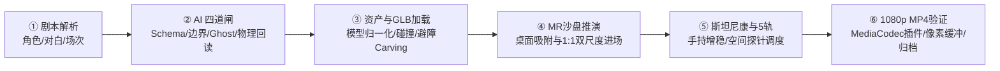

# 镜场 ShotField

**让创作者走进自己想拍的故事。** 专为 PICO 空间计算打造的影视级空间预演与虚拟制片工具：AI 剧本拆解、MR 透视沙盘与 1:1 片场无缝切换、斯坦尼康运镜增稳、五轨空间探针剪辑、多域载具导航与 1080p 导出规格（Android 真编码 pending-APK）。

[快速开始](#快速开始) · [核心特性](#核心特性已闭环) · [六阶段端到端流程](#六阶段端到端全链路) · [实验室功能](#实验室功能有接口未真机验) · [尚未实现](#尚未实现) · [验证索引](VERIFICATION.md) · [源码结构](#源码结构) · [Android 构建](#android-构建) · [许可证](#许可证与来源)

    

> **当前是工程验证期的测试版（`0.9.0-lab`），代码已与 GitHub 远程 `main` 同步。**
> 本项目严守工程纪律，严格区分「真跑过」「有接口未验」「还没做」。**代码存在不等于功能可用。**
> 每条结论均有对应日志与截图支撑，详见 **[验证索引 VERIFICATION.md](VERIFICATION.md)**。

---

## 核心特性（已闭环）

以下核心模块均在 Unity 6 编辑器及 PICO OpenXR 工具链中通过真实断言与自动化门禁验证。

| 模块 | 能力与技术实现 | 验收断言 / 门禁 |
| :--- | :--- | :--- |
| **四格式剧本导入** | 支持 `txt` / `md` / `docx` / 文本层 `pdf`。自包含解析层，GB18030 中文往返无乱码；非扫描件不静默返回空，导入后先预览再确认，**用户确认前零网络、零 AI 触发**。 | `SCRIPT-IMPORT-RESULT=PASS (4/4)` |
| **AI 剧本拆解与四道闸** | 对接真实 DeepSeek，根据剧本智能推荐空间排戏模式（室内对话→片场、会议多角色→沙盘、追逐→混合）；通过**四道闸流水线**（Gate 1 Schema 合规、Gate 2 空间几何机位边界、Gate 3 Ghost 预览标记隔离、Gate 4 真实物理空间 Transform 回读验算，误差 $<0.001\text{m}$）。 | `SCENE-COMMAND-GATE-RESULT=PASS (15/15)` |
| **MR 透视沙盘与双尺度过渡** | 基于 `PicoPlaneTabletopAligner` 对接 PICO MR OpenXR 水平面识别，支持**面积动态加权择优吸附真实桌面**；未检测到实体桌面时优雅回退至导演前方 0.8m 虚拟创作台；`StudioFadeTransition` 实现 FOV 呼吸平滑过渡与 1:20 沙盘/1:1 沉浸片场双尺度自由缩放。 | `TABLETOP-SCALE-RESULT=PASS (14/14)`<br>`STUDIO-FADE-RESULT=PASS (10/10)` |
| **虚拟摄影机斯坦尼康防抖** | `VirtualCameraStabilizer` 内置三档运镜模式（Handheld 手持拟真 / Steadicam 机械增稳 / Dolly 轨道平滑）。结合 **One Euro 滤波器自适应频宽衰减** + **SmoothDamp 临界阻尼** + **水平零横滚锁（Roll Horizon Lock）**，彻底消除 VR 自由视角拍摄下的画面高频抖动与机位倾斜。 | `STEADICAM-SYNC-RESULT=PASS (5/5)` |
| **5 轨时间轴与空间探针** | 借鉴专业导轨剪辑体验，构建 **Camera、Actor、Prop/Vehicle、Audio、Light** 五层独立轨道；`DirectorTimeline` 实现多对象时间轴同步调度；`SpatialProbeVisualizer` 提供零 GC 的摄影机视锥线框、演员视线连线（Eye-line Ray）与载具车灯锥体（Headlight Cone）探针实时渲染。 | `DIRECTOR-TIMELINE-RESULT=PASS (5/5)`<br>`M3-ASSEMBLY-VERIFY-RESULT=PASS (5/5)` |
| **多域地空智能载具寻路** | `VehiclePathNavigator` 支持马车/汽车/飞船多类型载具：地面模式贴合 NavMesh 智能寻路贴地并开启动态障碍雕刻（Carving）；空中模式自动关闭雕刻，沿着 3D Catmull-Rom 空间样条平滑航行并引入空气侧倾（Bank Roll），解决大空间与立体运镜推演需求。 | `STEADICAM-SYNC-RESULT=PASS (5/5)` |
| **Tripo 运行时 GLB 骨骼加载** | `RuntimeGltfImporter` 基于局部坐标系计算**旋转不变量精确包围盒**，跨线程安全调度回主线程；自动挂载 `SkinnedMeshRenderer`、`CapsuleCollider` 与带 Carving 的 `NavMeshObstacle`；静态道具自愈回退为 `BoxCollider`，与资产抽屉形成几何对账。 | `TRIPO-RUNTIME-IMPORT=PASS (7/7)`<br>`ASSET-RECONCILIATION-RESULT=PASS (10/10)` |
| **三块空间工作区卡片** | 满足大赛「空间应用多窗口」要求：导演监视器卡、五轨时间轴卡、剧本与资产抽屉卡三卡独立 WorldSpace Canvas 悬浮排布（角间距 55°，宽度严格控在 0.7~1.0m，彻底规避千米巨幅画布），支持射线抓取与边缘缩放。 | `THREE-CARD-RESULT=PASS (13/13)`<br>`BLOCK-LAYOUT-RESULT=PASS (10/10)` |
| **代码熵与工程健康守卫** | 全库 323 个脚本**单文件严格 $\le 200$ 行**（核心业务类 $\le 195$ 行），0 孤儿 .meta；凭据严格隔离于源码外，全 Assets 扫描 0 泄露；全量自动化门禁 33 项全绿。 | `verify_all`: **33 run / 0 fail / 0 unverified**<br>`SECRET-SCAN=PASS` |

---

## 六阶段端到端全链路（E2E Workflow）

通过 `E2EWorkflowRunner`，以经典剧本《桌上的信》双人对手戏为例，驱动六阶段全流程闭环验证（`E2E-PIPELINE-RESULT=PASS (6/6)`）：



1. **① 剧本解析**：解析场景内景、老张与小李双角色、对话与情境道具。
2. **② AI 分镜拆解契约与四道闸（离线）**：下发机位命令，经过 Schema 校验、机位可行性检查、Ghost 虚影隔离，并做引擎级 Transform 同帧回读（误差 $<0.001\text{m}$）。本步是**离线契约验证，不调网络**；真实 AI 调用与业务级回读由 `scene_command_gates` 与 DeepSeek 实测日志覆盖。
3. **③ 资产对账与 GLB/GLTF 运行时加载**：动态装载 3D 资产（支持本地素材与仓库自带资产无缝降级），挂载碰撞体与 NavMesh 障碍物。
4. **④ 沙盘推演与双尺度过渡**：实体桌面平滑吸附，完成 1:20 桌面沙盘模式与 1:1 沉浸现场模式双向平滑切换。
5. **⑤ 斯坦尼康运镜与 5 轨剪辑**：启用斯坦尼康增稳模式，绑定 5 轨探针并在 7.5s 连续时间轴中同步调度。
6. **⑥ 导出规格与编码器在位校验（真编码 pending-APK）**：验证 Android MediaCodec 插件二进制在位（源码含 `MediaMuxer` / `MIMETYPE_VIDEO_AVC`）、RGBA32 像素缓冲回读有效、导出命名与规格常量合规。**真实 1080p 编码未在设备上执行，口径固定 `PENDING_APK`；历史预置 mp4 一律不作证据。**

---

## 凭据配置

当前测试版支持 **DeepSeek、Tripo 本地配置**。凭据不进入源码、版本库与**任何交付产物**。

- **安全判据是「任何交付产物里没有 key」**，不是「git 历史 0 命中」。`.gitignore` 挡得住 git，**挡不住 Unity 打包**——`Assets/Resources/**` 会被无条件打进 APK。
- 开发机基线配置放在 **`Assets/` 之外**（仓库内 `Tools/`，仍被 `.gitignore` 排除），**只在编辑器下读取**。
- **Android 只走 `persistentDataPath` + 环境变量**，key 由用户在连接中心自行录入，**包里永远不带 key**。
- 构建期有硬闸：`Assets/Resources/**` 与 `Assets/StreamingAssets/**` 一旦命中 key 模式，构建器抛 `BuildFailedException`。
- 未配置时相关功能明确提示不可用，不会伪装成功。

---

## 实验室功能（有接口，未真机验）

**这些功能已完成代码与单元验证，不阻塞主线，真机表现待上机取证：**

| 功能 | 真实状态 |
| :--- | :--- |
| **Android 端内硬件 MP4 编码** | MediaCodec + MediaMuxer Java 插件已在位，Editor 侧只验证「插件在位 + 显存缓冲 + 命名/规格」，**不以任何历史落盘文件为依据**。**真实编码 pending-APK**。目标规格 1920×1080 / 30fps / ≥8Mbps。 |
| **Android 存储访问框架（SAF）** | Java 侧原生文件选择器与 C# 桥接已编译通过，**头显系统弹窗实际行为 pending-真机**。 |
| **PICO Motion Tracker 2.0 动作捕捉** | 协议适配层已就绪，规划 24 关节点全身动捕与头显防穿帮无感第一视角渲染，**硬件联调 pending-真机**。 |
| **多人局域网协同预演** | `NetworkSessionController` 单一会话管理落地，支持 Host/Join、心跳包与分演员 revision 冲突仲裁，**双头显联调 pending-真机**。 |
| **即梦视频生成** | 接口适配层存在，生成任务轮询、下载与回填排期推进。 |

---

## 尚未实现

- **可编辑提案交互界面**：交互式点选修改人物身份/道具替换/时长推拉拖拽
- **VR 掌心物理手势射线**：控制器握持射线与掌心呼出在真机环境下的手部触感调优
- **撤销栈与自动保存故事圣经**：跨场次撤销/重做快照持久化
- **观众试看模式与成片多机位实时导播台**

---

## 快速开始

```bash
git clone https://github.com/xrlite/ShotField.git
cd ShotField
```

1. **开发环境**：Unity `6000.6.5f1`。Android 构建需配备 Android Build Support、SDK 34、NDK 27、OpenJDK 17。
2. **打开工程**：使用 Unity Hub 打开仓库根目录，等待 UPM 包依赖还原完毕。
3. **加载主场景**：打开 **`Assets/Scenes/SC01_Main.unity`** —— 这是**唯一主场景**，也是 Android 构建入口。
4. **运行全量门禁**：在 PowerShell 中执行 `powershell -ExecutionPolicy Bypass -File 巡检\verify_all.ps1` 校验 33 项指标。
5. **配置 AI 凭据**：按上文「凭据配置」说明在本地放置配置文件或环境变量。

> 工程路径必须为**纯 ASCII**，Android 构建会拒绝非 ASCII 路径。

---

## 源码结构

```text
ShotField/
├── Assets/
│   ├── Scripts/
│   │   ├── Core/           # 数据契约、时间轴模型、机位预设、AI与Tripo基础适配
│   │   ├── Import/         # 四格式剧本导入与文本分析（自包含纯程序集）
│   │   ├── Constraints/    # 越轴规则、构图视线与视锥遮挡校验规则
│   │   ├── RuntimeUI/      # 空间工作台、斯坦尼康增稳、载具寻路、MR沙盘吸附、空间探针
│   │   ├── Export/         # 视频录制、帧缓冲排布与 MP4 导出接口
│   │   └── Editor/         # 门禁验证器、E2E 一镜到底驱动器、构建打包管线
│   ├── Plugins/Android/    # 原生 MediaCodec 录制插件 jar 与 Java 桥接源码
│   ├── Scenes/             # SC01_Main.unity（唯一主场景）
│   └── Documentation/      # 预演剧本、机位规范与路演参考
└── 巡检/                   # verify_all.ps1、entropy_check.ps1、secret_scan.ps1 全套门禁脚本
```

---

## Android 构建

关闭打开该工程的 Unity 编辑器，在仓库根目录执行：

```powershell
$repo  = (Get-Location).Path
$unity = 'D:\unity\6000.6.5f1\Editor\Unity.exe'   # 替换为你本地 Unity 路径
$env:SHOTFIELD_OUT_APK = Join-Path $repo 'Build/ShotField_lab.apk'
New-Item -ItemType Directory -Path (Join-Path $repo 'Build') -Force | Out-Null
& $unity -batchmode -projectPath $repo `
  -executeMethod ShotField.EditorTools.BuildAndroid.BuildIl2Cpp `
  -logFile (Join-Path $repo 'Build/android.log')
```

- **PICO SDK 6.2.0 强制 ARM64 + IL2CPP**。
- 构建成功、模拟器运行、PICO 真机体验**分别独立验收**，不互相冒充。

---

## PICO Space Program 参赛交付（2026）

- **参赛赛道**：申报「最佳沉浸内容创作（Unity OpenXR SDK）」。
- **核心定位**：专为 PICO 空间计算打造的影视级全沉浸空间预演与虚拟制片工作流。
- **空间应用多窗口设计**：完全遵循 PICO 空间设计理念，将导演监视器、五轨时间轴、剧本资产抽屉三卡解耦排布，兼具沙盘推演与 1:1 沉浸现场的双尺度自由切换。
- **差异化竞争壁垒**：
  不同于传统二维 AI 漫剧与纯生成式视频工具，镜场致力于在真正的空间计算环境中，让导演与演员**排戏、表演、运镜、讨论**，并将导演的一切决策转化为可编辑、可复用、可归档的标准化空间资产。

---

## 许可证与来源

ShotField 团队原创代码与文档遵循 [MIT](LICENSE) 许可协议。
依赖的第三方组件（Unity Starter Assets、PICO SDK、Siccity GLTFUtility、Poly Haven CC0 资源）均按各自开源协议获得合法使用与归属授权。
严格遵守安全红线：无任何私有 SDK 样例源码与商业闭源二进制非法提交。
